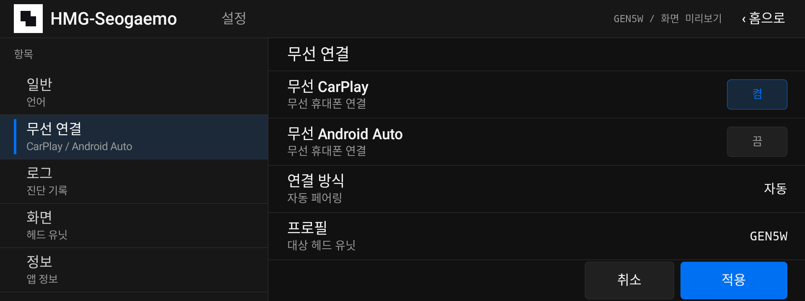
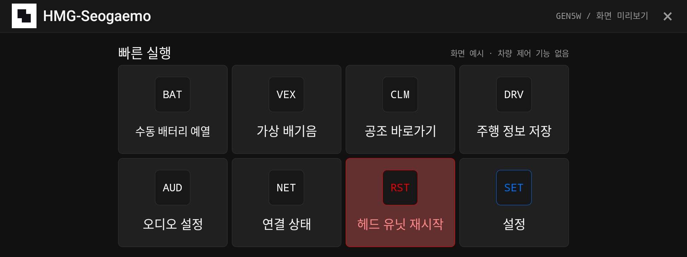

# hmg-seogaemo

UI-only mock for the Gen5W head unit (1920×720, hdpi).

## Screenshots

Korean home with placeholder vehicle actions.

Korean Settings with the Language choice selected.

Korean Settings with Wireless projection selected.

Korean Settings with Logs selected.

Restart head unit tile while pressed; no command runs.
