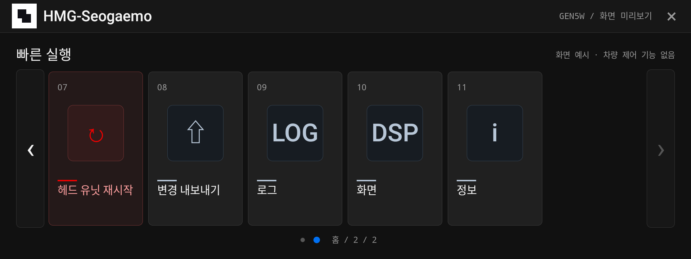

# hmg-seogaemo

UI-only mock for the Gen5W head unit (1920×720, hdpi).

## Screenshots

Korean Home page 1 with six portrait mock tiles; Settings is first.

Korean Home page 2 with the destructive Restart tile and remaining shortcuts.

Korean Settings with the Language choice selected.

Korean Settings with Wireless projection selected.

Korean Settings with Logs selected.

Restart head unit tile while pressed; no command runs.
