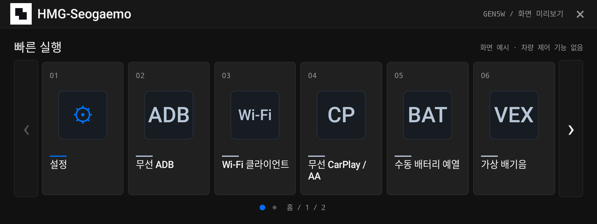
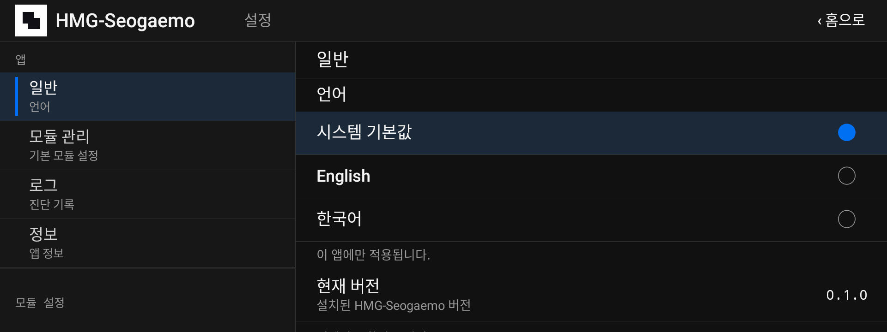
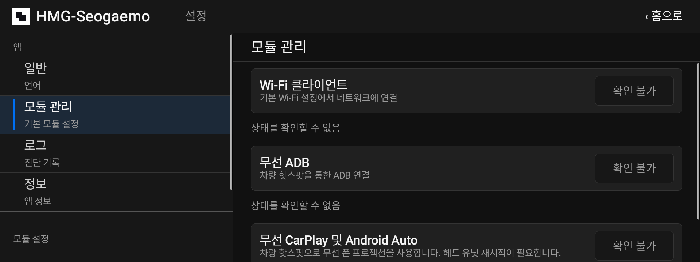
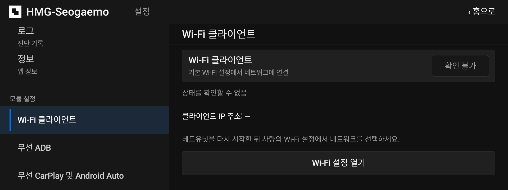
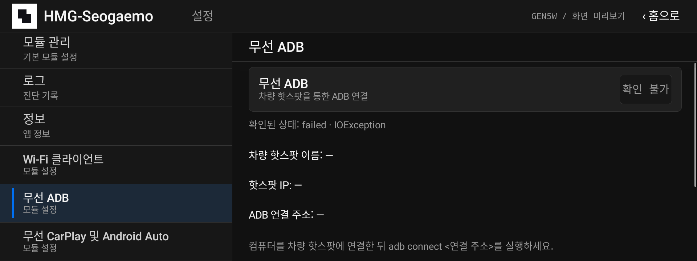
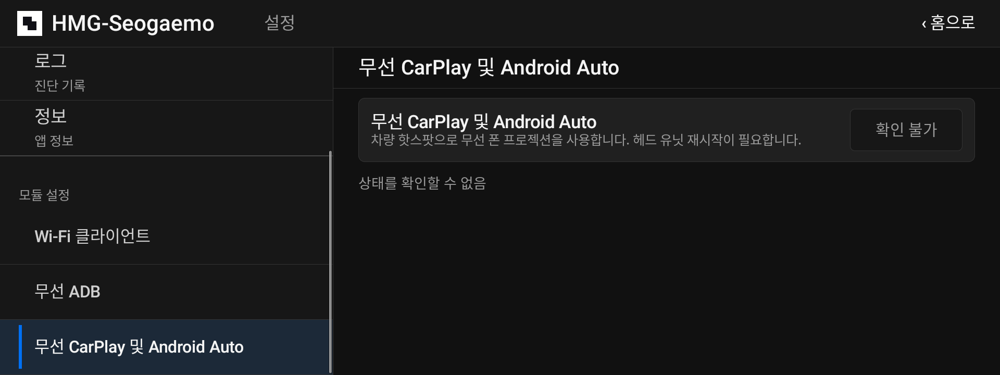
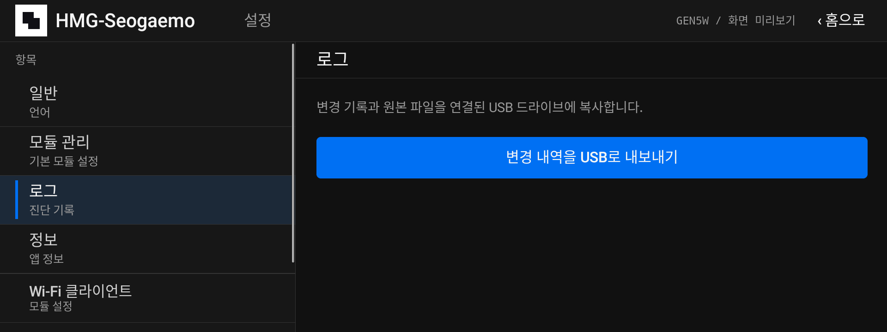

# HMG-Seogaemo

HMG-Seogaemo is a Gen5W head-unit app and NEMESIS package with toggleable Wi-Fi client, wireless ADB, and wireless CarPlay and Android Auto modules. The app also supports OTA updates from GitHub Releases.

## Install

Download `hmg-seogaemo-<v>-nemesis-usb.zip` from [Releases](https://github.com/seogaemo/hmg-seogaemo/releases), unzip it to an empty FAT32 or exFAT USB stick, and install it through NEMESIS. Remove HMG-API and HMG Leafia Plus before installing.

## Build

```sh
make
make test
make package
```

## Screenshots

### Home



### Settings — General



### Module management



### Wi-Fi client



### Wireless ADB



### Wireless CarPlay and Android Auto



### Logs



## License

HMG-Seogaemo is licensed under [GNU AGPL-3.0](LICENSE). See [NOTICE.md](NOTICE.md) for upstream credits.
